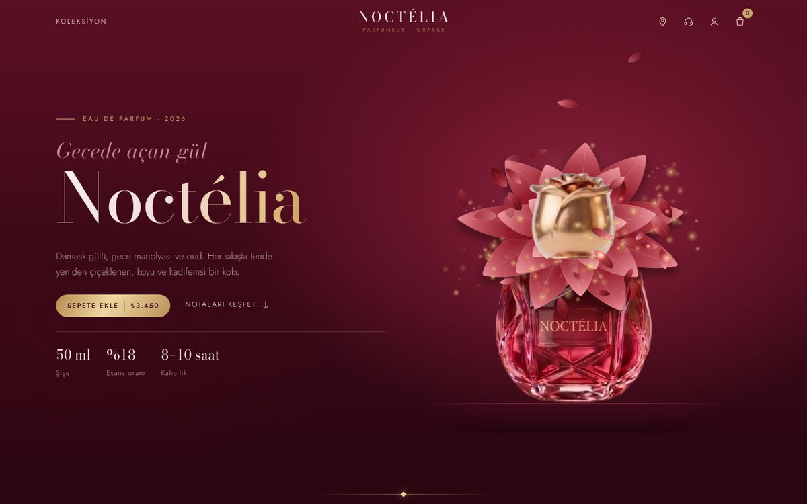
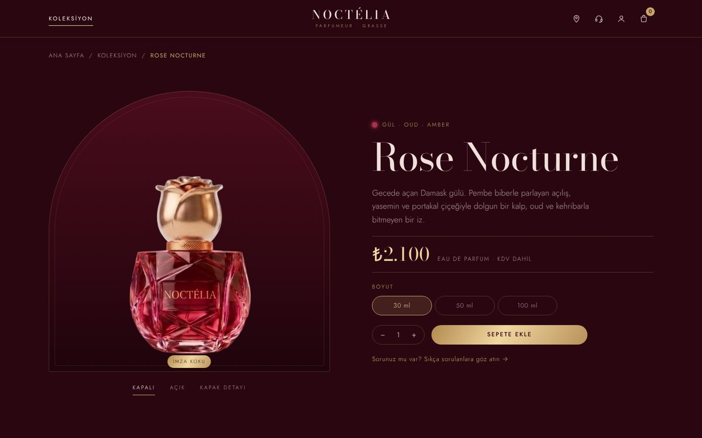

# Noctélia — Luxury Perfume Website

An animated, multi-page e-commerce showcase I designed and built for a fictional luxury perfume brand.

**[Live demo](https://noctelia-website.vercel.app)** · [Türkçe](README.md)

| Home | Product page |
| --- | --- |
| [](https://noctelia-website.vercel.app) | [](https://noctelia-website.vercel.app/urun?id=rose-nocturne) |

## About

This is a portfolio project. My goal was to capture the feel of a luxury brand website through scroll-driven animation, and to build it without a framework while keeping it smooth. Noctélia is not a real brand; nothing is sold on the site and the forms don't send data anywhere. The site content is in Turkish.

## Features

- **Opening animation:** The cap lifts, the spray presses and an SVG rose blooms out of the bottle, with petals and particles drifting around it before the loop restarts.
- **Scroll-driven transition:** As you scroll down, the rose folds back into the bottle, the cap closes and the bottle shrinks into the center of the fragrance pyramid. Scrolling up plays the same path in reverse.
- **Fragrance pyramid:** The lines draw themselves and the top, heart and base notes light up in order. Each product page reuses the same structure with its own bottle and notes.
- **Collection:** Nine fragrances with family filters, price sorting and quick add-to-cart.
- **Product page:** Closed, open and cap-detail views; 30 / 50 / 100 ml sizes, quantity and a sticky buy bar on mobile.
- **Find your scent:** A four-question quiz that suggests the closest match and two alternatives.
- **Stores:** Leaflet map with location search.
- **Cart and account:** Slide-out cart panel, cart page, sign-in and sign-up flow.
- **Also:** FAQ, legal pages (privacy, cookies, terms), 404 page, separate desktop and mobile layouts, `prefers-reduced-motion` support

## Technical notes

- The rose is an SVG scene whose petals are generated in JavaScript. Drifting petals and particles are drawn on two Canvas 2D layers placed behind and in front of that scene to create depth.
- Scroll animations use GSAP ScrollTrigger and smooth scrolling uses Lenis. Animations are turned off for users who prefer reduced motion.
- Product names, prices, notes and descriptions come from a single `PRODUCTS` list in `js/store.js`, shared by the collection, product page, quiz and cart.
- Cart and account data are stored only in the browser (`localStorage`).
- Pages are linked without the `.html` extension (`/koleksiyon`, `/urun?id=rose-nocturne`) via the `cleanUrls` setting in `vercel.json`.

## Running

There is no build step. Serve the folder with a static server that supports extensionless URLs:

```bash
npx serve -l 5173
```

Then open `http://localhost:5173`. It can be deployed to Vercel as-is.

## Project structure

```
├── index.html          # home: opening, fragrance pyramid, story, collection, newsletter
├── koleksiyon.html     # collection with filters and sorting
├── urun.html           # product page
├── kokunu-bul.html     # scent quiz
├── sepet.html, hesap.html, magazalar.html, sss.html, yasal.html, 404.html
├── vercel.json         # extensionless URLs
├── css/style.css
├── js/main.js          # home page animations
├── js/store.js         # product data, cart and shared components
├── js/page.js          # inner pages
└── assets/img/
```

## Tech stack

HTML, CSS, JavaScript · GSAP + ScrollTrigger · Lenis · SVG · Canvas 2D · Leaflet

## License

© 2026 Efnan Yılmaz. All rights reserved. The code, design and images may not be copied or used without permission. See [LICENSE](LICENSE) for details.

---

Design and development: **Efnan Yılmaz** · [LinkedIn](https://linkedin.com/in/efnanyilmaz)
