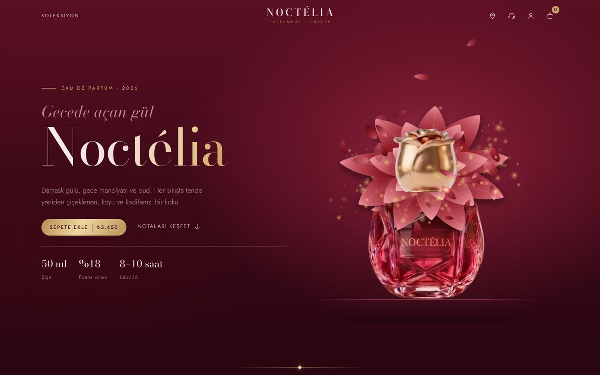
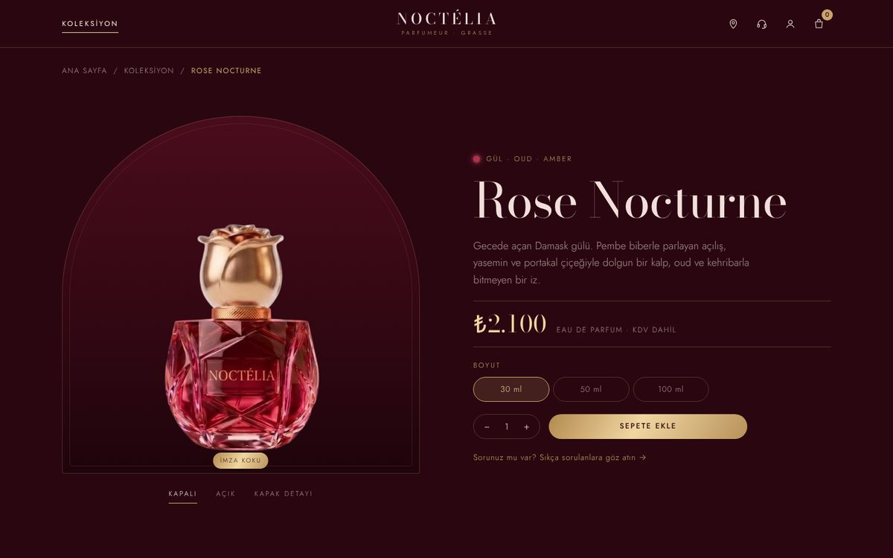

# Noctélia — Lüks Parfüm Sitesi

Hayali bir lüks parfüm markası için tasarlayıp geliştirdiğim, animasyonlu ve çok sayfalı bir e-ticaret vitrin sitesi.

**[Canlı demo](https://noctelia-website.vercel.app)** · [English](README.en.md)

| Ana sayfa | Ürün sayfası |
| --- | --- |
| [](https://noctelia-website.vercel.app) | [](https://noctelia-website.vercel.app/urun?id=rose-nocturne) |

## Proje hakkında

Bu bir portfolyo çalışması. Amacım, bir lüks markanın sitesinde beklenen hissi kaydırmaya bağlı animasyonlarla vermek ve bunu bir framework kullanmadan, akıcı çalışacak şekilde kurmaktı. Noctélia gerçek bir marka değildir; sitede satış yapılmaz ve formlar hiçbir yere veri göndermez.

## Özellikler

- **Açılış animasyonu:** Kapak kalkar, sprey basılır ve şişeden SVG ile çizilmiş bir gül açar; etrafında yapraklar ve parçacıklar uçuşur, sonra döngü baştan başlar.
- **Kaydırmaya bağlı geçiş:** Aşağı kaydırıldıkça gül şişeye geri katlanır, kapak kapanır ve şişe küçülerek koku piramidinin ortasına iner. Yukarı kaydırınca aynı yoldan geri döner.
- **Koku piramidi:** Çizgiler kendini çizer; üst, kalp ve dip notaları sırayla belirir. Ürün sayfalarında her koku kendi şişesi ve notalarıyla aynı yapıyı kullanır.
- **Koleksiyon:** Dokuz koku; aile filtresi, fiyat sıralaması ve hızlı sepete ekleme.
- **Ürün sayfası:** Kapalı, açık ve kapak detayı görünümleri; 30 / 50 / 100 ml seçimi, adet ve mobilde sabit satın alma çubuğu.
- **Kokunu bul:** Dört soruluk test; sonuçta en uygun koku ve iki alternatif önerilir.
- **Mağazalar:** Leaflet haritası ve konuma göre arama.
- **Sepet ve hesap:** Yandan açılan sepet paneli, sepet sayfası, giriş ve üyelik akışı.
- **Ayrıca:** SSS, yasal metinler (KVKK, çerezler, kullanım koşulları), 404 sayfası, masaüstü ve mobil için ayrı düzen, `prefers-reduced-motion` desteği

## Teknik notlar

- Gül, yaprakları JavaScript ile üretilen bir SVG sahnesi. Uçuşan yapraklar ve parçacıklar bu sahnenin arkasında ve önünde duran iki ayrı Canvas 2D katmanında çiziliyor; böylece derinlik hissi oluşuyor.
- Kaydırma animasyonları GSAP ScrollTrigger ile, yumuşak kaydırma Lenis ile yapılıyor. Hareketi azaltmayı seçen kullanıcılarda animasyonlar kapanıyor.
- Ürün adları, fiyatlar, notalar ve açıklamalar `js/store.js` içindeki tek bir `PRODUCTS` listesinden geliyor; koleksiyon, ürün sayfası, test ve sepet bu listeyi kullanıyor.
- Sepet ve hesap verileri yalnızca tarayıcıda (`localStorage`) tutuluyor.
- Sayfalar `.html` uzantısı olmadan (`/koleksiyon`, `/urun?id=rose-nocturne`) bağlanıyor; bunu `vercel.json` içindeki `cleanUrls` ayarı sağlıyor.

## Çalıştırma

Derleme adımı yoktur. Uzantısız adresleri destekleyen bir statik sunucu ile açın:

```bash
npx serve -l 5173
```

Ardından `http://localhost:5173` adresine gidin. Vercel'e olduğu gibi yüklenebilir.

## Klasör yapısı

```
├── index.html          # ana sayfa: açılış, koku piramidi, hikâye, koleksiyon, bülten
├── koleksiyon.html     # tüm kokular, filtre ve sıralama
├── urun.html           # ürün sayfası
├── kokunu-bul.html     # koku testi
├── sepet.html, hesap.html, magazalar.html, sss.html, yasal.html, 404.html
├── vercel.json         # uzantısız adresler
├── css/style.css
├── js/main.js          # ana sayfa animasyonları
├── js/store.js         # ürün verisi, sepet ve ortak bileşenler
├── js/page.js          # iç sayfalar
└── assets/img/
```

## Teknolojiler

HTML, CSS, JavaScript · GSAP + ScrollTrigger · Lenis · SVG · Canvas 2D · Leaflet

## Lisans

© 2026 Efnan Yılmaz. Tüm hakları saklıdır. Kod, tasarım ve görseller izinsiz kopyalanamaz veya kullanılamaz. Ayrıntılar için [LICENSE](LICENSE) dosyasına bakın.

---

Tasarım ve geliştirme: **Efnan Yılmaz** · [LinkedIn](https://linkedin.com/in/efnanyilmaz)
